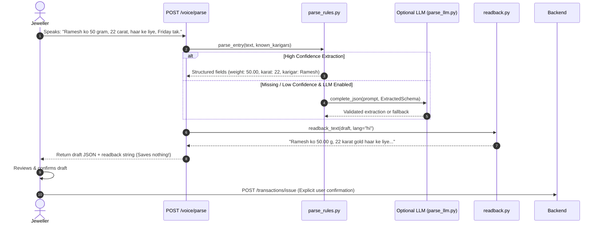
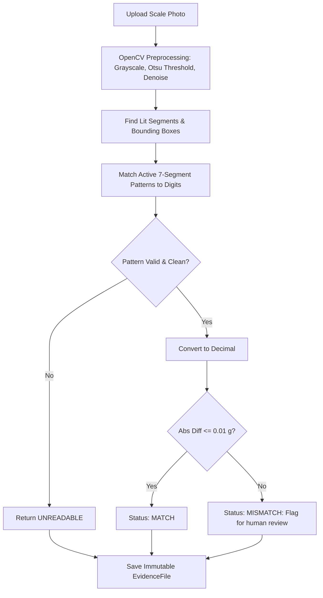

# AI / ML & Agentic System Workflow

## 1. Architectural Philosophy
The AI layer in this project operates strictly on an **Advisory & Deterministic-First** philosophy:
1. **Deterministic Foundation First**: All core gold arithmetic, purity conversions, dispute splitting, and reconciliation equations run through pure Python `core_engine` functions using exact `Decimal` precision. An AI model is **never** permitted to calculate gold balances or financial amounts.
2. **Defensive AI Integration**:
   - Voice parsing utilizes an offline, deterministic regex & rule-based parser as the primary baseline.
   - LLMs are optional enhancers for phrasing or complex linguistic extraction. Their outputs are untrusted and strictly validated against Pydantic schemas. If unavailable or invalid, the system falls back seamlessly to rule parsing.
   - Scale-Photo Witness employs a classic computer vision seven-segment decoder that abstains (`UNREADABLE`) rather than hallucinating an inaccurate weight.
3. **Hard Permission Boundaries**:
   - The AI Agent acts via an authenticated HTTP Gateway with a dedicated `agent` role.
   - The backend enforces `require_roles("jeweller", "karigar")` on all write and state-modifying endpoints (`approve`, `resolve`, `confirm`, `edit`). The agent gets `403 Forbidden` if it attempts any authoritative state modification.

---

## 2. Voice Khata Workflow

### Parsing Rules & Field Extraction
- **Karigar Matching**: Fuzzy matching using `difflib.get_close_matches` against the jeweller's associated karigars. If ambiguous or unknown, the system asks a question instead of guessing.
- **Weight & Karat**: Regex extraction matching `gram/gm/g` and `karat/carat/kt/k`. Out-of-range karats (< 1 or > 24) are rejected.
- **Due Date**: Identifies weekdays (e.g., `Friday tak`) and relative dates (`tomorrow`). Ambiguous terms like Hindi `kal` (which can mean yesterday or tomorrow) trigger an explicit clarification question.

---

## 3. Scale-Photo Witness Workflow

- **Honest Scope**: The scale photo verifies only what was displayed on the scale. It does not certify gold purity, alloy integrity, or replace physical hallmarking.

---

## 4. Agentic AI Workflows & Boundary Defense

### Permitted Capabilities (ALLOWED)
- `read`: Read order status, pending entries, and transaction history.
- `remind`: Dispatch deadline and dispute follow-up notifications.
- `summarise`: Generate neutral, fact-only summaries of disputes or orders.
- `draft_settlement`: Calculate reconciliation values and prepare a settlement proposal.
- `suggest_reweigh`: Suggest calibrated reweighing when weights diverge.
- `log`: Log agent tasks to `agent_tasks` table.

### Prohibited Actions (FORBIDDEN - Enforced by Code & RBAC)
- `resolve_dispute`: **FORBIDDEN** (Requires mutual human approval).
- `approve_settlement`: **FORBIDDEN** (Requires mutual jeweller & karigar approval).
- `reject_settlement`: **FORBIDDEN**.
- `release_hold`: **FORBIDDEN**.
- `edit_value`: **FORBIDDEN** (Original records immutable).
- `confirm_entry`: **FORBIDDEN**.
- `decide_who_is_right`: **FORBIDDEN**.

### Neutrality Guardrail
All agent-generated summaries pass through `is_neutral(text)` regex filter to reject judgmental or verdict terminology (`cheat`, `guilty`, `at fault`, `lying`, `is right`, `should be paid`). If biased language is detected, the agent reverts to deterministic factual templates.
